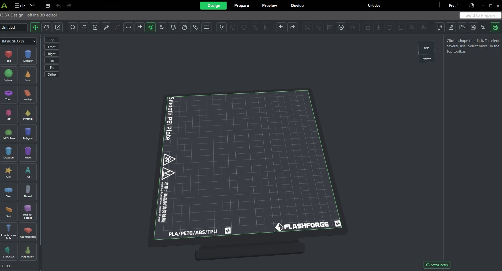
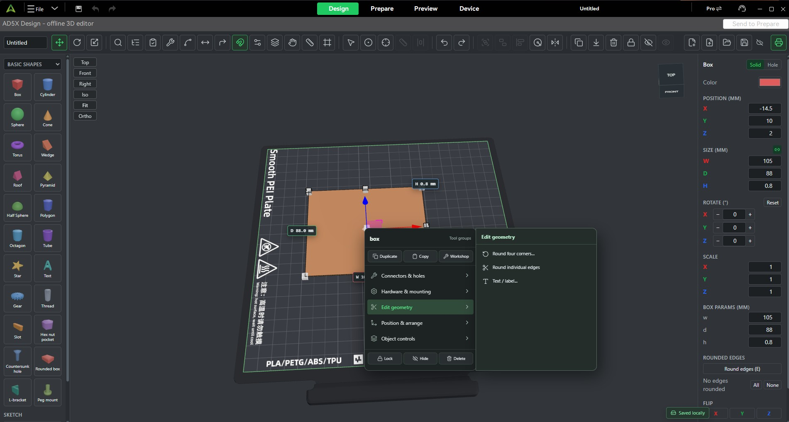
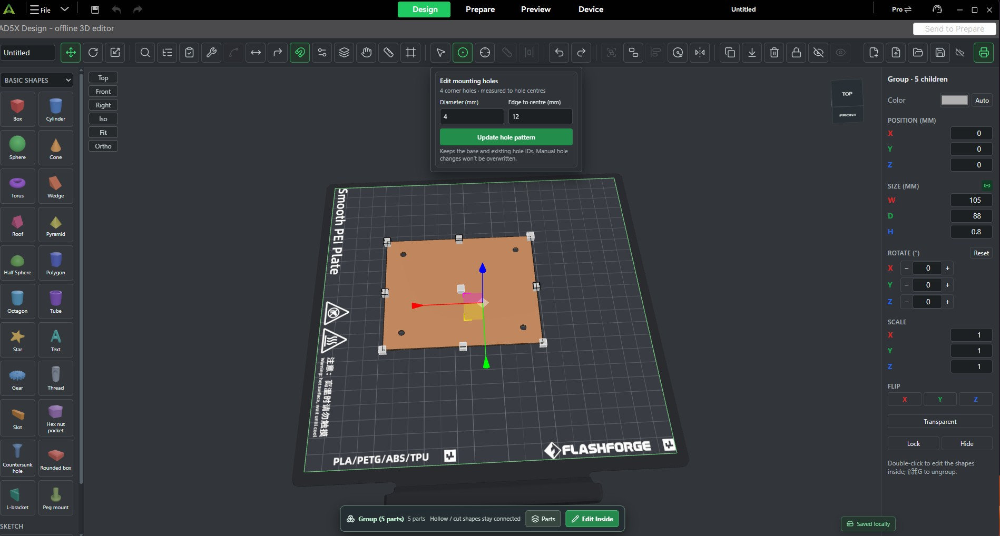

# CrealityPrint AD5X Community

**Creality Print 7.3 with a built-in offline Design workspace for making practical 3D-printable parts, then sending them straight to Prepare, slice and print.**

> Unofficial community fork. **Not affiliated with or endorsed by Creality.**

*Click the screenshot above to watch the 42-second Design → Prepare → Preview demo.*

### [Download the Windows RC1 installer](https://github.com/OrryZA1/CrealityPrint-AD5X-Community/releases/tag/v7.3.0-ad5x-rc1)

**Release:** `v7.3.0-ad5x-rc1`

**Installer:** `CrealityPrint_7.3_AD5X_Offline_RC1_Setup.exe`

**SHA-256:** `F11686C0904A7D07BF0F89EC5845913765B3D2903203FD3B5E873ACB61ACD05E`

---

## Design inside the slicer

The main reason this fork exists is the **Design** tab.

It is a first-class workspace inside the native Creality Print application, aimed at people who want to make useful printable parts quickly without leaving the slicer for traditional CAD.

**Design → Prepare → Slice / Preview → Print**

### [▶ Watch the 42-second tray Design → Prepare → Preview demo](https://raw.githubusercontent.com/OrryZA1/CrealityPrint-AD5X-Community/master/docs/media/design-tray-demo.mp4)

The demo shows a tray starting as simple geometry, being hollowed and divided, edited with practical tools, then handed directly into **Prepare** and **Preview**.

### What can you make?

The current Design workspace includes tools for:

- organizers, trays, removable bins and dividers;
- boxes, shells, lids and hinged enclosures;
- electronics enclosures and panel work;
- connector holes and component cut-outs;
- PCB mounting/alignment and drilling jigs;
- pogo-pin guides and wire combs;
- mounting holes and bolt patterns;
- adjustable clamps and practical fixtures;
- text, labels, mirroring, patterns, grouping and precise placement;
- STL export and editable project data;
- STEP export through the optional local FreeCAD/OpenCascade bridge.

It is meant to be **practical CAD for 3D printing**, not a claim to replace full mechanical CAD packages.

## Task-oriented tools

Instead of forcing every job through sketches and a feature tree, the Design tab exposes the jobs people actually need for printed parts.

Examples include:

- **Connectors & holes**
- **Hardware & mounting**
- **Edit geometry**
- **Position & arrange**
- **Object controls**
- guided organizer/enclosure/jig workflows
- component placement onto selected enclosure walls

## Parametric mounting features

Dimensions stay editable rather than becoming a one-off mesh.

The mounting-hole workflow, for example, lets you control hole diameter and edge-to-centre placement and then regenerate the feature on the selected object.

## The Design source is included

The accepted Design frontend/CAD source is published in:

[`design/`](design/)

That directory contains the React/TypeScript UI, CAD/CSG logic, scene/history system, practical enclosure and jig tools, component library, offline assets, extension definitions and regression fixtures.

The public copy was independently checked on **26 October 2026**:

- **87 / 87 test files passed**
- **635 / 635 tests passed**
- **TypeScript/Vite/PWA production build passed**

See [design/README.md](design/README.md) for architecture, build instructions, accepted evidence and current integration limits.

### Design lineage

The Design editor began from the AGPL-3.0 open-source **Sculpo** project and was substantially modified for this built-in Creality Print workflow.

See [design/NOTICE.md](design/NOTICE.md) and [THIRD_PARTY.md](THIRD_PARTY.md).

---

## AD5X / offline changes

Alongside Design, this fork preserves the Creality Print 7.3 slicing workflow while adapting the application for the project's FlashForge AD5X environment.

The public source includes work around:

- FlashForge AD5X machine/profile resources;
- AD5X filament and process presets;
- AD5X device/status integration;
- Klipper/Fluidd-oriented device workflow;
- Send Print / native Prepare handoff integration;
- four-channel IFS-related machine/workflow support;
- frozen in-app executable update checks;
- cloud home disabled by default;
- Creality Cloud identity removed from the offline Device flow;
- cloud printing/model search/recommendations disabled;
- preset/cloud sync guarded or disabled by default;
- machine-specific debug logging removed or redirected.

The original CrealityPrint slicing engine remains the base of the project.

## RC1 verification

The released installer has been verified for:

- installer compilation;
- isolated installation;
- **10,269 / 10,269** installed application file hashes;
- **211 / 211** seeded configuration files;
- isolated uninstall;
- preservation of the packaged RC1 application payload.

Before final packaging, project acceptance covered startup, Design/Prepare, slicing/preview, Device/Fluidd and Send Print. The final packaging pass itself did **not** repeat a new physical print and full post-installer GUI acceptance cycle, so those earlier functional results are not represented as a fresh installer-level retest.

## Important signing note

The retained upstream `CrealityPrint.exe` has a valid vendor signature.

The custom RC1 installer and modified `CrealityPrint_Slicer.dll` are currently **unsigned**. Smart App Control or other application-control policy may therefore require additional trust/signing work.

## Source / build

- Creality Print build notes: [BUILDING.md](BUILDING.md)
- Design build notes: [design/README.md](design/README.md)
- Changes: [CHANGELOG.md](CHANGELOG.md)
- RC1 evidence and limitations: [RELEASE_NOTES_RC1.md](RELEASE_NOTES_RC1.md)
- Third-party/upstream notes: [THIRD_PARTY.md](THIRD_PARTY.md)
- Original Creality README: [UPSTREAM_README.md](UPSTREAM_README.md)

## Upstream and licence

This fork is based on [CrealityOfficial/CrealityPrint](https://github.com/CrealityOfficial/CrealityPrint), which in turn derives from OrcaSlicer, Bambu Studio, PrusaSlicer and Slic3r.

The project remains licensed under **GNU AGPL v3.0**. See [LICENSE.txt](LICENSE.txt).

Upstream Creality precompiled dependencies such as `cr_FillTensor` and `cr_tpms` are preserved with their existing provenance; see [THIRD_PARTY.md](THIRD_PARTY.md).

Trademarks and product names belong to their respective owners.
